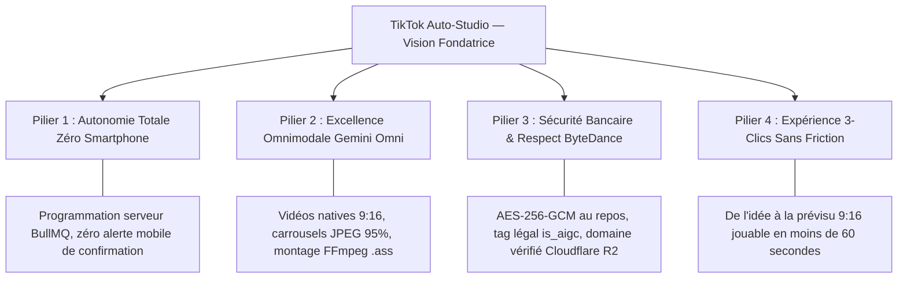
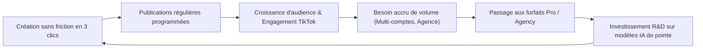

	# Vision Stratégique & Manifeste Produit — TikTok Auto-Studio

> **Nom du Projet :** TikTok Auto-Studio  
> **Document :** Vision Fondatrice & Manifeste  
> **Statut :** Document Maître de Référence  
> **Auteur(s) :** Principal Software Architect, Staff Fullstack AI Engineer & Head of Product  
> **Dernière mise à jour :** 30 Octobre 2026

---

## 1. Manifeste & Raison d'Être

### 1.1 Le Constat Fondateur
La vidéo verticale courte (9:16) est devenue le format roi de l'attention mondiale. TikTok capte plus de 1,5 milliard d'utilisateurs actifs mensuels et représente le principal moteur de découverte, de réputation et de conversion commerciale pour les marques et créateurs.

Pourtant, une anomalie persiste : **la création régulière sur TikTok est un enfer logistique**.
- Trouver une idée percutante, rédiger une accroche (*hook*), concevoir des scènes visuelles, monter, sous-titrer et synchroniser la voix réclame entre **45 minutes et 2 heures par vidéo**.
- Pour nourrir l'algorithme, il faut poster 1 à 3 fois par jour, 7 jours sur 7.
- La quasi-totalité des créateurs et des équipes marketing s'épuisent (*burnout* créatif) ou abandonnent au bout de 90 jours.
- Les solutions artisanales actuelles (outils de contournement, bots d'automatisation non officiels, émulateurs) entraînent le bannissement irrémédiable des comptes (*shadowban*).

### 1.2 Notre Thèse
> **"La barrière technique et logistique de création ne doit plus être le facteur limitant du succès sur TikTok."**

Nous croyons que n'importe quelle marque, entrepreneur ou créateur doit pouvoir transformer une idée brute en un contenu de grade professionnel en **moins de 60 secondes**, et le programmer pour publication directe **sans jamais avoir à ouvrir son smartphone**.

**TikTok Auto-Studio** n'est pas un bot de spam. C'est un **studio de production cinématographique et d'automatisation éthique**, adossé aux APIs officielles de TikTok et propulsé par l'intelligence artificielle omnimodale de Google.

---

## 2. La North Star Metric (NSM) & Objectifs Stratégiques

### 2.1 La North Star Metric
Notre boussole unique de succès est :
$$\text{NSM} = \textbf{Nombre de vidéos et carrousels d'excellence générés par IA et publiés avec succès sans friction}$$

Cette métrique réunit :
- La satisfaction créative (l'utilisateur valide le post généré).
- La fiabilité technique (le post est publié à la seconde exacte sans échec réseau).
- L'adoption SaaS pérenne (l'utilisateur renouvelle sa confiance jour après jour).

### 2.2 Objectifs Stratégiques à 24 Mois
1. **Zéro Échec de Publication :** Taux de disponibilité et de ponctualité de diffusion $\ge 99.9\%$.
2. **Time-to-Publish < 60s :** Permettre la génération complète d'un script + vidéo native ou carrousel en 3 clics et moins d'une minute.
3. **100% de Conformité ByteDance :** Zéro incident de conformité, zéro suspension de compte liée à nos flux officiels.
4. **Adoption SaaS à Grande Échelle :** Atteindre 10 000 créateurs actifs et 1 500 agences d'ici fin 2027.

---

## 3. Les 4 Piliers Inviolables de la Vision Produit

### Pilier 1 : Autonomie Totale « Zéro Smartphone »
L'utilisateur ne doit plus être l'esclave de son téléphone. Notre architecture serveur exécute les publications à l'heure programmée, gère les renouvellements de jetons en coulisses, et répare automatiquement les retards mineurs en cas d'interruption serveur grâce à la règle des 15 minutes.

### Pilier 2 : Excellence Omnimodale Native (Gemini Omni)
Nous ne nous contentons pas de concaténer des images statiques. Grâce à l'architecture omnimodale de **Google Gemini Omni**, nous offrons le choix entre :
- La génération vidéo directe native avec motion fluide et cinématique verticale 9:16.
- Le montage composite dynamique combinant visuels photoréalistes, voix-off rythmée et sous-titres karaoké animés.
- Des carrousels photos percutants respectant rigoureusement les contraintes de formatage de TikTok (conversion automatique en JPEG 95%).

### Pilier 3 : Sécurité Bancaire & Respect Strict de ByteDance
La réputation et les accès de nos clients sont sacrés :
- Les tokens d'accès TikTok sont chiffrés avec le même niveau d'exigence qu'une institution financière (**AES-256-GCM** avec IV unique et Auth Tag).
- Zéro secret exposé au client.
- Respect absolu des politiques d'étiquetage IA (`is_aigc: true`) et hébergement des médias sur domaine validé DNS auprès de TikTok.

### Pilier 4 : Expérience Produit en 3 Clics
La simplicité radicale l'emporte toujours sur la complexité. Pas de timeline lourde de 40 pistes :
- **Clic 1 :** Saisie de l'idée et choix du format.
- **Clic 2 :** Génération multimodale en temps réel (60 secondes).
- **Clic 3 :** Validation sur la prévisualisation smartphone réaliste et déclenchement (Publication ou Programmation).

---

## 4. Modèle Économique & Moteur de Croissance (Flywheel)

Le produit repose sur un modèle d'abonnement récurrent (SaaS) adossé à une limitation saine par quotas journaliers d'inférence :

### Formules Proposées :
- **Free :** Découverte de la plateforme (1 compte TikTok, 3 générations IA/jour).
- **Pro (29 €/mois) :** Le standard pour infopreneurs et créateurs réguliers (3 comptes, 25 générations/jour, vidéos jusqu'à 180s).
- **Agency (99 €/mois) :** La centrale de commande pour marques et gestionnaires de communauté (15 comptes, 100 générations/jour, collaboration d'équipe).

---

## 5. Moat Défensif (Avantages Concurrentiels Pérennes)

1. **La Légitimité API Officielle :** Alors que les concurrents non agréés subissent les blocages constants de TikTok, notre statut d'application auditée et certifiée garantit la pérennité absolue des comptes connectés.
2. **Le Pipeline Omnimodal Intégré :** L'intégration native de Gemini Omni pour la vidéo et l'image 9:16 supprime le besoin de combiner 4 abonnements distincts (Midjourney + ElevenLabs + CapCut + Buffer).
3. **Le Moteur de Résilience BullMQ :** Une garantie d'idempotence et d'auto-guérison face aux pannes serveur qu'aucun script amateur ne peut égaler.

---

## 6. Trajectoire d'Impact & Horizon Futur

- **Horizon 1 (Aujourd'hui — V1.0) :** Valider l'audit commercial TikTok, asseoir la réputation de sécurité cryptographique et offrir le Studio IA 3-clics parfait.
- **Horizon 2 (6 à 12 mois — V1.5) :** Déployer la monétisation Stripe à grande échelle, ouvrir le mode public complet et enrichir l'observabilité.
- **Horizon 3 (12 à 24 mois — V2.0) :** Étendre le moteur de publication omnicanale vers Instagram Reels et YouTube Shorts, permettant à un créateur d'alimenter tout l'écosystème de la vidéo verticale mondiale à partir d'une seule idée.
