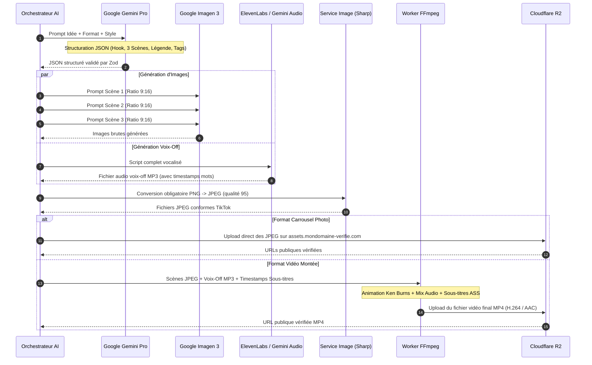

# Technical Requirements Document (Spécifications Techniques d'Architecture) — TikTok Auto-Studio

> **Nom du Projet :** TikTok Auto-Studio  
> **Document :** Technical Requirements Document (Architecture, Stack & Protocoles)  
> **Version :** 1.0.0  
> **Statut :** Validé — Spécification d'Architecture Technique  
> **Auteur(s) :** Principal Software Architect & Staff Fullstack AI Engineer  
> **Dernière mise à jour :** 30 Octobre 2026

---

## 1. Stack Technologique & Justifications d'Ingénierie (Monorepo Découplé)

| Couche | Technologie Retenue | Justification Technique & Rôle |
| :--- | :--- | :--- |
| **Frontend Web (SPA)** | **React 18/19 + Vite + TypeScript** | Application monopage ultra-véloce (`apps/web`), montage instantané, Hot Module Replacement (HMR) immédiat, bundle optimisé. |
| **Routage & Gestion d'État Client** | **React Router v6 + TanStack Query** | Routage déclaratif côté client, cache et synchronisation asynchrone des données serveur sans requêtes superflues. |
| **Serveur Backend HTTP** | **Node.js 20+ LTS (Fastify / Express)** | Serveur d'API dédié haute performance (`apps/api`), gestion native des flux asynchrones, middleware CORS avec `credentials: true`. |
| **Langage & Typage Strict** | **TypeScript 5.x (Strict Mode)** | Typage statique de bout en bout (`noImplicitAny`, `strictNullChecks`), code partagé entre front et back via `packages/shared`. |
| **Composants UI & Design** | **TailwindCSS v3 + Shadcn/ui + Lucide Icons** | Design system modulaire sombre, composable, responsive, adapté à la timeline vidéo et aux prévisualisations 9:16. |
| **Validation des Données** | **Zod 3.x (Package Partagé)** | Validation stricte aux frontières réseau : formulaires client React, requêtes HTTP API Node.js et réponses JSON IA. |
| **ORM & Modélisation** | **Prisma ORM 5.x** | Abstraction typée pour PostgreSQL, migrations déclaratives déterministes, gestion fluide des transactions ACID. |
| **Base de Données Relationnelle** | **PostgreSQL 16** | Persistance relationnelle pour les utilisateurs, comptes TikTok, métadonnées des posts, audits logs et quotas. |
| **File d'Attente & Cache** | **Redis 7.x + BullMQ 5.x** | Planification temporelle à haute précision, gestion des verrous distribués (Redlock), backoff exponentiel et déduplication par `jobId`. |
| **Stockage Médias & CDN** | **Cloudflare R2 (S3-compatible)** | Zéro coût d'egress, liaison directe avec un sous-domaine vérifié DNS auprès de TikTok (`assets.mondomaine-verifie.com`), latence globale minime. |
| **Moteur Vidéo Composite & Subtitles** | **Worker FFmpeg 6.x (Dockerisé)** | Concaténation de scènes, animation Ken Burns pour mode composite, mixage audio voix-off + musique, gravure des sous-titres `.ass`. |
| **IA Omnimodale (Texte, Image & Vidéo)** | **Google Gemini Omni** | Génération de bout en bout : scripts structurés JSON Zod, génération d'images 9:16 et génération native de vidéos verticales fluides. |
| **Génération Visuelle Dédiée** | **Google Imagen 3 (via Gemini API)** | Rendu d'images photoréalistes verticales 9:16 (1080x1920) pour carrousels avec post-traitement de conversion PNG vers JPEG/WEBP. |
| **Synthèse Vocale (TTS)** | **Gemini Speech / ElevenLabs API** | Audio MP3 voix française/anglaise naturelle synchronisée avec les timestamps des sous-titres. |
| **Chiffrement au Repos** | **Node.js Crypto (AES-256-GCM)** | Chiffrement symétrique authentifié des tokens TikTok (clé 256 bits, IV 96 bits, Auth Tag 128 bits). |

---

## 2. Architecture Système & Découpage en Couches

```mermaid
flowchart TD
    subgraph Client ["Frontend React SPA (Vite - Port 5173)"]
        UI_Studio["Studio 3-Clics & Prévisu 9:16"]
        UI_Calendar["Calendrier de Programmation"]
        UI_Settings["Gestion Comptes & Paramètres"]
        API_Client["Client Axios / TanStack Query (withCredentials: true)"]
        
        UI_Studio --> API_Client
        UI_Calendar --> API_Client
        UI_Settings --> API_Client
    end

    subgraph API_Gateway ["Backend Node.js API (Fastify / Express - Port 4000)"]
        CorsMiddleware["CORS Handler (Origin: localhost:5173 / Whitelist)"]
        AuthMiddleware["Session Middleware (Cookies HttpOnly SameSite=Lax/Strict)"]
        Router["REST Router (/auth, /ai, /posts, /media)"]
        ZodValidator["Validateur Zod (Package Shared)"]
        CryptoEngine["Crypto Engine (AES-256-GCM)"]
    end

    subgraph Business_Services ["Couche Services Métier (Node.js)"]
        TikTokService["TikTok API Client (v2 OAuth & Publish)"]
        AIService["AI Orchestrator (Google Gemini Omni & Imagen 3)"]
        StorageService["S3 / R2 Asset Manager (Conversion JPEG Sharp)"]
        QuotaService["Sliding Window Quotas Engine"]
    end

    subgraph Async_Engine ["Moteur Asynchrone (Background Workers)"]
        BullMQQueue["Redis BullMQ Queue (tiktok-publish-queue)"]
        PublishWorker["Worker de Publication TikTok"]
        FFmpegWorker["Worker de Montage Vidéo FFmpeg"]
    end

    subgraph Persistence ["Persistance & Infrastructure"]
        PostgresDB[(PostgreSQL 16)]
        RedisStore[(Redis 7)]
        R2Bucket[(Cloudflare R2 - Verified Domain)]
        TikTokEndpoints["API Officielle TikTok v2"]
    end

    Client -->|HTTPS / REST (CORS + Credentials)| CorsMiddleware
    CorsMiddleware --> AuthMiddleware
    AuthMiddleware --> Router
    Router --> ZodValidator
    ZodValidator --> Business_Services
    Business_Services --> CryptoEngine
    Business_Services --> PostgresDB
    Business_Services --> StorageService
    StorageService --> R2Bucket

    Business_Services -->|Enqueue Job (delay, jobId)| BullMQQueue
    BullMQQueue --> RedisStore
    RedisStore --> PublishWorker
    RedisStore --> FFmpegWorker

    PublishWorker --> CryptoEngine
    PublishWorker --> TikTokService
    TikTokService --> TikTokEndpoints
    FFmpegWorker --> StorageService
```
    Router --> ZodValidator
    ZodValidator --> Business_Services
    Business_Services --> CryptoEngine
    Business_Services --> PostgresDB
    Business_Services --> StorageService
    StorageService --> R2Bucket

    Business_Services -->|Enqueue Job (delay, jobId)| BullMQQueue
    BullMQQueue --> RedisStore
    RedisStore --> PublishWorker
    RedisStore --> FFmpegWorker

    PublishWorker --> CryptoEngine
    PublishWorker --> TikTokService
    TikTokService --> TikTokEndpoints
    FFmpegWorker --> StorageService
```

---

## 3. Spécifications du Pipeline Multimodal & Worker FFmpeg

### 3.1 Pipeline de Transformation Multimodale



### 3.2 Spécification de la Commande FFmpeg (Montage Automatisé)

Pour une séquence de $N$ scènes d'une durée $D_i$ secondes chacune, le worker FFmpeg exécute :
- **Filtre Vidéo Ken Burns :**
  ```bash
  ffmpeg -loop 1 -t 4.5 -i scene1.jpg \
    -loop 1 -t 4.5 -i scene2.jpg \
    -loop 1 -t 5.0 -i scene3.jpg \
    -i voiceover.mp3 \
    -filter_complex "\
      [0:v]scale=8000x-1,zoompan=z='min(zoom+0.0015,1.25)':d=135:x='iw/2-(iw/zoom/2)':y='ih/2-(ih/zoom/2)':s=1080x1920:fps=30[v0]; \
      [1:v]scale=8000x-1,zoompan=z='min(max(zoom,1.25)-0.0015,1.0)':d=135:x='iw/2-(iw/zoom/2)':y='ih/2-(ih/zoom/2)':s=1080x1920:fps=30[v1]; \
      [2:v]scale=8000x-1,zoompan=z='min(zoom+0.0015,1.25)':d=150:x='iw/2-(iw/zoom/2)':y='ih/2-(ih/zoom/2)':s=1080x1920:fps=30[v2]; \
      [v0][v1][v2]concat=n=3:v=1:a=0[v_concat]; \
      [v_concat]subtitles=subtitles.ass:force_style='Alignment=2,FontSize=24,PrimaryColour=&H00FFFFFF,OutlineColour=&H00000000,BorderStyle=3'[v_out] \
    " \
    -map "[v_out]" -map 3:a \
    -c:v libx264 -preset fast -crf 22 -pix_fmt yuv420p \
    -c:a aac -b:a 192k -ar 44100 \
    -shortest output_tiktok_916.mp4
  ```

---

## 4. Spécifications du Moteur de Planification & Résilience (BullMQ)

### 4.1 Configuration de la File & Verrouillage Distribué
- **Nom de la Queue :** `tiktok-publish-queue`
- **Idempotency Key (jobId) :** `"post_" + post.id`
  - Tout appel `queue.add()` avec un `jobId` existant est ignoré par BullMQ, interdisant toute duplication d'envoi.
- **Verrou Redlock :** Acquisition d'un verrou distribué Redis `lock:post:<id>` avec TTL de 120 secondes lors du traitement par le worker.

### 4.2 Matrice de Retries & Stratégie de Backoff

| Type d'Erreur | Cause | Action Immédiate | Stratégie de Réessai | Statut Final si Échec |
| :--- | :--- | :--- | :--- | :--- |
| **HTTP 5xx (500, 502, 503, 504)** | Défaillance temporaire serveur TikTok | Log dans `PublishAuditLog` | Backoff exponentiel (1m, 5m, 15m) — Max 3 tentatives | `FAILED` |
| **HTTP 429** | Rate limit API TikTok atteint | Lecture header `Retry-After` | Délai forcé = `Retry-After` (max 30m) | `FAILED` si $> 30\text{m}$ |
| **HTTP 401 / 403** | Token révoqué ou permissions insuffisantes | Déclenchement Refresh Token | 1 tentative après refresh, arrêt immédiat sinon | `FAILED` (alerte ré-auth) |
| **HTTP 400 (Bad Request)** | Format média invalide ou URL inaccessible | Arrêt immédiat (non réessayable) | Aucune réessai (erreur de validation) | `FAILED` |
| **Crash Serveur / Reboot** | Redémarrage imprévu de l'instance worker | Analyse au démarrage des jobs passés | **Règle des 15 minutes** (voir 4.3) | `RECOVERED` ou `MISSED` |

### 4.3 Implémentation Algorithmique de la Règle des 15 Minutes

```typescript
export async function handleOrphanedScheduledPost(post: PostWithAccount): Promise<void> {
  const now = new Date();
  const scheduledTime = new Date(post.scheduledAt);
  const delayMinutes = (now.getTime() - scheduledTime.getTime()) / (1000 * 60);

  if (delayMinutes <= 15) {
    // Retard toléré : Exécution d'urgence immédiate
    await logAudit(post.id, "RECOVERED_EXECUTION", { delayMinutes });
    await publishPostWorkflow(post.id);
  } else {
    // Retard critique (> 15 min) : Bascule en statut MISSED pour protéger l'audience
    await prisma.post.update({
      where: { id: post.id },
      data: { status: "MISSED" }
    });
    await logAudit(post.id, "JOB_MARKED_MISSED", {
      scheduledAt: post.scheduledAt,
      detectedAt: now,
      delayMinutes
    });
    await notifyUserMissedPost(post.userId, post.id);
  }
}
```

---

## 5. Contraintes Non-Fonctionnelles & SLAs

### 5.1 Performance & Latence
- **Temps de réponse Dashboard & API :** $p95 < 250\text{ ms}$ pour les opérations de lecture/écriture CRUD.
- **Délai de précision de publication :** Le worker doit initier l'appel TikTok dans les **3 secondes** suivant l'échéance programmée.
- **Durée de génération multimodale :** $\le 60\text{ secondes}$ au $p90$ pour un carrousel complet ou une vidéo de 15 secondes.

### 5.2 Scalabilité & Concurrence
- Dimensionnement initial : Prise en charge de 10 000 utilisateurs actifs, 50 000 publications planifiées par mois, et 1 000 jobs concurrents sur le cluster Redis/BullMQ.
- Séparation stricte du pool de workers (BullMQ Worker tournant dans un process Node.js distinct du serveur Next.js Web).

### 5.3 Sécurité & Rétention des Données
- Aucune donnée vidéo ou image non publiée conservée au-delà de 30 jours (politique de purge automatique S3 Lifecycle).
- Chiffrement TLS 1.3 en transit, AES-256-GCM au repos pour les secrets.
- Conformité RGPD : Révocation en 1 clic entraînant la suppression cryptographique complète des tokens et métadonnées associées.
