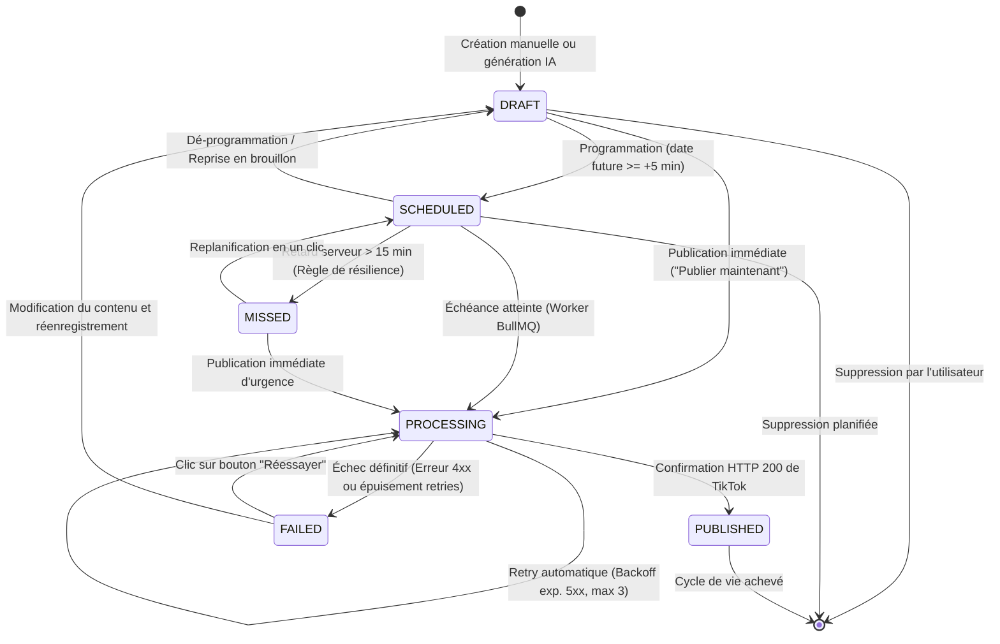
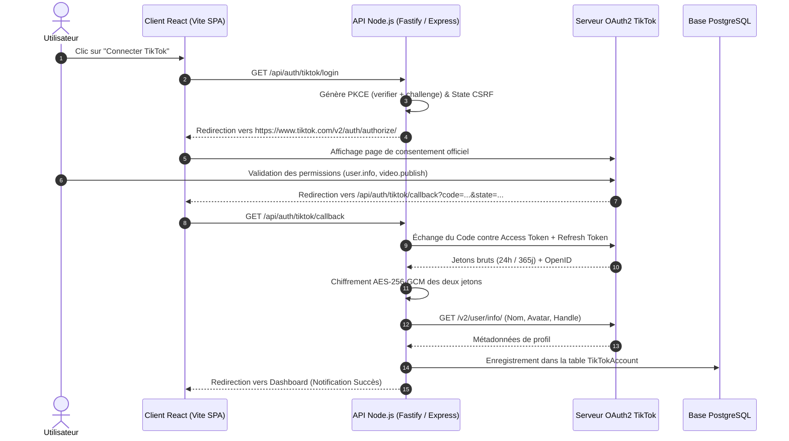
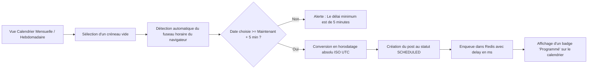

# Application Flow & UX Architecture (APP_FLOW) — TikTok Auto-Studio

> **Nom du Projet :** TikTok Auto-Studio  
> **Version :** 1.0.0  
> **Statut :** Validé — Spécification des Parcours Utilisateurs & Cinématiques d'Écran  
> **Auteur(s) :** Principal Software Architect & Staff Fullstack AI Engineer  
> **Dernière mise à jour :** 30 Octobre 2026

---

## 1. Machine à États Formelle du Post

Le cycle de vie complet d'un post (qu'il soit issu du mode manuel ou du Studio IA) est modélisé par une machine à états finis déterministe interdisant toute transition incohérente.



### 1.1 Définition des Statuts

| Statut | Description Métier | Actions Utilisateur Disponibles | Actions Système |
| :--- | :--- | :--- | :--- |
| **`DRAFT`** | Brouillon en cours d'édition, média uploadé ou généré. | Modifier texte, changer média, publier, programmer, supprimer. | Purge si inactif $> 30$ jours. |
| **`SCHEDULED`** | Job enregistré dans BullMQ avec délai d'attente. | Modifier la date, annuler la programmation, modifier la légende. | Surveillance par Redis / BullMQ. |
| **`PROCESSING`** | Job en cours d'exécution par le worker (upload R2 / appel API). | Lecture seule (indicateur de chargement temps réel). | Verrou distribué Redlock actif. |
| **`PUBLISHED`** | Publication confirmée et visible sur TikTok. | Consulter sur TikTok (lien direct), voir les logs d'audit. | Archivage des métadonnées. |
| **`FAILED`** | Échec de publication (erreur réseau persistante ou token invalide). | Bouton "Réessayer", "Modifier en brouillon", voir le motif d'erreur. | Notification d'échec envoyée. |
| **`MISSED`** | Heure dépassée de $> 15$ min suite à un crash serveur. | Bouton "Replanifier", "Publier maintenant". | Notification d'alerte spécifique. |

---

## 2. Parcours Utilisateurs Principaux

### 2.1 Parcours 1 : Connexion Initiale du Compte TikTok (UC1)



### 2.2 Parcours 2 : Le Studio IA en 3 Clics (UC4)

```mermaid
flowchart TD
    Start([Écran Studio IA]) --> Step1[Clic 1 : Saisie de l'Idée]
    Step1 --> InputField[/Idée : "3 erreurs fatales en prospection B2B"/]
    InputField --> SelectFormat[Sélection : Carrousel, Vidéo Native Omni ou Vidéo Composite FFmpeg]
    SelectFormat --> ClickGen[Clic sur "Générer avec l'IA"]

    ClickGen --> Validation{Quota IA restant ?}
    Validation -- Non --> ModalUpgrade[Modal : Quota épuisé, passer au plan Pro]
    Validation -- Oui --> Step2[Clic 2 : Inférence Omnimodale 60s]

    subgraph Generation_Pipeline ["Pipeline d'Inférence Omnimodale (Gemini Omni)"]
        Step2 --> LLM[Google Gemini Omni : Script structuré Zod, hook, tags]
        LLM --> BranchFormat{Format Choisi ?}
        
        BranchFormat -- "Vidéo Native Omni" --> OmniVideo[Gemini Omni Video Engine : Rendu MP4 9:16 direct]
        
        BranchFormat -- "Carrousel Photos" --> ImgGen[Gemini Omni & Imagen 3 : Visuels 9:16]
        ImgGen --> ConvertSharp[Sharp : Conversion PNG -> JPEG 95%]
        
        BranchFormat -- "Vidéo Composite" --> ImgScenes[Visuels Scènes 9:16 + Voix TTS]
        ImgScenes --> FFmpegWorker[Worker FFmpeg : Montage Ken Burns + Sous-titres ASS]
        
        OmniVideo --> CloudflareR2[Upload R2 : Domaine Vérifié TikTok]
        ConvertSharp --> CloudflareR2
        FFmpegWorker --> CloudflareR2
    end

    CloudflareR2 --> Step3[Clic 3 : Validation & Choix d'Envoi]
    Step3 --> PreviewCard[Aperçu Interactif 9:16 : Vidéo jouable & Légende]
    PreviewCard --> UserChoice{Action Utilisateur ?}

    UserChoice -- "Publier Maintenant" --> PostNow[UC5 : Publication immédiate]
    UserChoice -- "Programmer" --> OpenPicker[UC3 : Sélecteur de date/heure]
    UserChoice -- "Enregistrer Brouillon" --> SaveDraft[Post passe en DRAFT]
```

### 2.3 Parcours 3 : Calendrier Interactif & Programmation (UC3)



---

## 3. Cinématique des Écrans & Gestion des États UI

Chaque écran de la plateforme implémente les 4 états canoniques :
1. **Loading State :** Skeletons animés aux dimensions exactes du contenu pour éviter tout layout shift (CLS).
2. **Error State :** Message contextualisé en français avec action de remédiation immédiate (ex: *"Bouton Réessayer"* ou *"Reconnecter TikTok"*).
3. **Empty State :** Illustration thématique, texte explicatif et bouton d'action principal (Call To Action).
4. **Success State :** Feedback visuel non bloquant (Toasts Sonner) et mise à jour optimiste de l'UI.

### 3.1 Tableau Comparatif des États par Écran

| Écran | Empty State (Vide) | Loading State (Chargement) | Error State (Erreur) | Success State (Nominal) |
| :--- | :--- | :--- | :--- | :--- |
| **Dashboard / Accueil** | "Aucun post programmé. Lancez votre première création avec l'IA en 3 clics !" + Bouton CTA Studio. | Grille de 6 cartes avec skeletons gris animés et compteurs de quotas pulsants. | Bannière rouge : "Connexion au serveur perdue" + Bouton Actualiser. | Métriques du jour, quotas restants, liste des 5 prochains posts programmés. |
| **Studio IA 3-Clics** | Formulaire d'idée vide avec 3 suggestions de prompts viraux cliquables. | Barre de progression en 4 étapes animées : (1) Idée $\rightarrow$ (2) Visuels $\rightarrow$ (3) Voix $\rightarrow$ (4) Montage. | Message d'alerte rouge : "Contenu refusé par le filtre de sécurité" ou "Quota épuisé". | Lecteur vidéo vertical 9:16 jouable avec boutons "Publier", "Programmer" et "Modifier". |
| **Calendrier** | Grille calendaire vide avec les créneaux d'audience optimale surlignés en pointillé vert. | Skeleton de calendrier avec shimmer effect sur les 7 colonnes de la semaine. | "Impossible de charger les posts du mois" + Bouton Retry. | Pastilles colorées par post : Bleu (Programmé), Orange (En cours), Vert (Publié), Rouge (Échec). |
| **Gestion Comptes** | "Aucun compte TikTok relié" + Gros bouton officiel "Connect with TikTok". | Skeleton de carte profil (cercle avatar + 2 lignes de texte). | "Le jeton TikTok est révoqué" + Bouton Reconnecter immédiat. | Carte du compte : Avatar officiel, Handle, Badge "Vérifié", Scopes accordés, Expiration Refresh Token. |

---

## 4. Règles d'Interaction & Ergonomie

1. **Format Responsive :**
   - Sur Desktop : Affichage côte à côte (Formulaire à gauche, Prévisualisation smartphone 9:16 à droite).
   - Sur Mobile / Tablette : Onglets basculables "Édition" / "Aperçu".
2. **Prévisualisation TikTok Réaliste :**
   - Le player 9:16 affiche en surimpression les icônes standards TikTok (Cœur, Commentaire, Partage, Disque musical) afin que l'utilisateur vérifie qu'aucun texte ou sous-titre n'est masqué par les boutons natifs de TikTok.
3. **Zone de Sécurité TikTok (Safe Area) :**
   - Guidage visuel optionnel (grille de safe area) : 150px en haut (onglets Pour Toi), 200px en bas (légende et audio), 100px à droite (boutons d'action).
