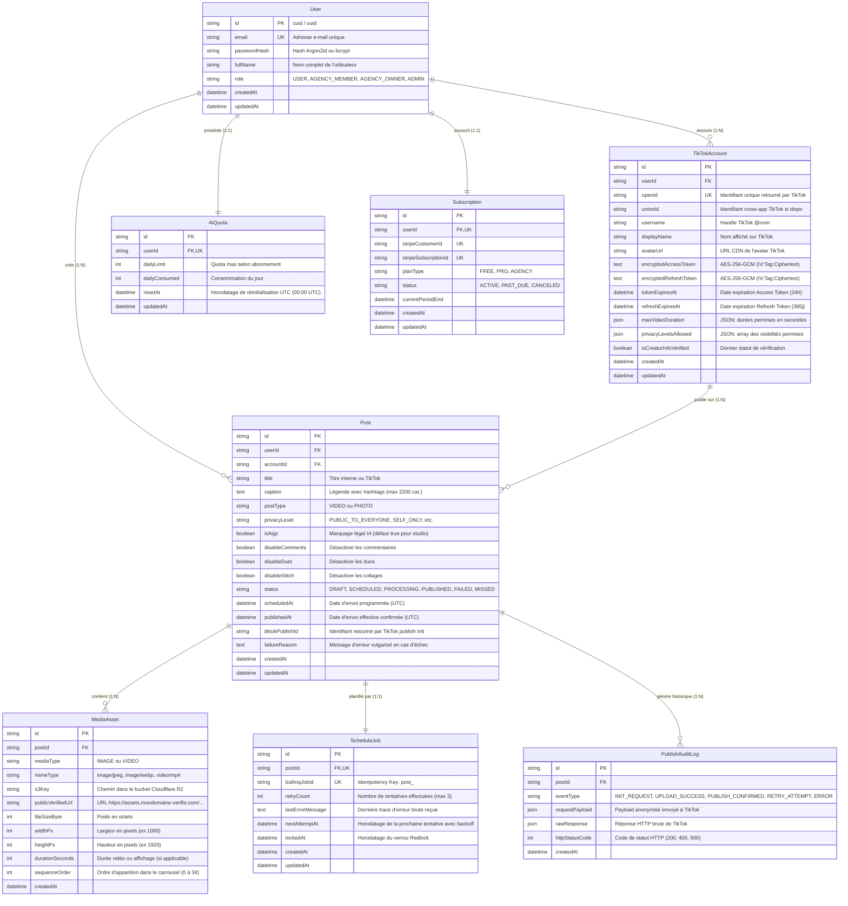

# Backend Schema & Database Architecture (BACKEND_SCHEMA) — TikTok Auto-Studio

> **Nom du Projet :** TikTok Auto-Studio  
> **Version :** 1.0.0  
> **Statut :** Validé — Schéma Relationnel & Spécifications Prisma ORM  
> **Auteur(s) :** Principal Software Architect & Staff Fullstack AI Engineer  
> **Dernière mise à jour :** 30 Octobre 2026

---

## 1. Diagramme Entité-Relation (ERD Mermaid)



---

## 2. Déclaration Exhaustive du Schéma Prisma (`schema.prisma`)

```prisma
datasource db {
  provider = "postgresql"
  url      = env("DATABASE_URL")
}

generator client {
  provider = "prisma-client-js"
}

enum Role {
  USER
  AGENCY_MEMBER
  AGENCY_OWNER
  ADMIN
}

enum SubscriptionPlan {
  FREE
  PRO
  AGENCY
}

enum SubscriptionStatus {
  ACTIVE
  PAST_DUE
  CANCELED
}

enum PostType {
  VIDEO
  PHOTO
}

enum PostStatus {
  DRAFT
  SCHEDULED
  PROCESSING
  PUBLISHED
  FAILED
  MISSED
}

enum PrivacyLevel {
  PUBLIC_TO_EVERYONE
  MUTUAL_FOLLOW_FRIENDS
  FOLLOWER_OF_CREATOR
  SELF_ONLY
}

enum MediaType {
  IMAGE
  VIDEO
}

model User {
  id            String          @id @default(uuid())
  email         String          @unique
  passwordHash  String          @map("password_hash")
  fullName      String          @map("full_name")
  role          Role            @default(USER)
  createdAt     DateTime        @default(now()) @map("created_at")
  updatedAt     DateTime        @updatedAt @map("updated_at")

  tiktokAccounts TikTokAccount[]
  posts          Post[]
  subscription   Subscription?
  aiQuota        AiQuota?

  @@map("users")
}

model Subscription {
  id                    String             @id @default(uuid())
  userId                String             @unique @map("user_id")
  stripeCustomerId      String?            @unique @map("stripe_customer_id")
  stripeSubscriptionId  String?            @unique @map("stripe_subscription_id")
  planType              SubscriptionPlan   @default(FREE) @map("plan_type")
  status                SubscriptionStatus @default(ACTIVE)
  currentPeriodEnd      DateTime?          @map("current_period_end")
  createdAt             DateTime           @default(now()) @map("created_at")
  updatedAt             DateTime           @updatedAt @map("updated_at")

  user                  User               @relation(fields: [userId], references: [id], onDelete: Cascade)

  @@map("subscriptions")
}

model AiQuota {
  id            String    @id @default(uuid())
  userId        String    @unique @map("user_id")
  dailyLimit    Int       @default(3) @map("daily_limit")
  dailyConsumed Int       @default(0) @map("daily_consumed")
  resetAt       DateTime  @map("reset_at")
  updatedAt     DateTime  @updatedAt @map("updated_at")

  user          User      @relation(fields: [userId], references: [id], onDelete: Cascade)

  @@map("ai_quotas")
}

model TikTokAccount {
  id                    String        @id @default(uuid())
  userId                String        @map("user_id")
  openId                String        @unique @map("open_id")
  unionId               String?       @map("union_id")
  username              String
  displayName           String        @map("display_name")
  avatarUrl             String        @map("avatar_url")
  encryptedAccessToken  String        @map("encrypted_access_token")
  encryptedRefreshToken String        @map("encrypted_refresh_token")
  tokenExpiresAt        DateTime      @map("token_expires_at")
  refreshExpiresAt      DateTime      @map("refresh_expires_at")
  maxVideoDuration      Json          @map("max_video_duration")
  privacyLevelsAllowed  Json          @map("privacy_levels_allowed")
  isCreatorInfoVerified Boolean       @default(false) @map("is_creator_info_verified")
  createdAt             DateTime      @default(now()) @map("created_at")
  updatedAt             DateTime      @updatedAt @map("updated_at")

  user                  User          @relation(fields: [userId], references: [id], onDelete: Cascade)
  posts                 Post[]

  @@index([userId])
  @@map("tiktok_accounts")
}

model Post {
  id                String            @id @default(uuid())
  userId            String            @map("user_id")
  accountId         String            @map("account_id")
  title             String            @db.VarChar(150)
  caption           String            @db.VarChar(2200)
  postType          PostType          @map("post_type")
  privacyLevel      PrivacyLevel      @default(SELF_ONLY) @map("privacy_level")
  isAigc            Boolean           @default(true) @map("is_aigc")
  disableComments   Boolean           @default(false) @map("disable_comments")
  disableDuet       Boolean           @default(false) @map("disable_duet")
  disableStitch     Boolean           @default(false) @map("disable_stitch")
  status            PostStatus        @default(DRAFT)
  scheduledAt       DateTime?         @map("scheduled_at")
  publishedAt       DateTime?         @map("published_at")
  tiktokPublishId   String?           @map("tiktok_publish_id")
  failureReason     String?           @map("failure_reason")
  createdAt         DateTime          @default(now()) @map("created_at")
  updatedAt         DateTime          @updatedAt @map("updated_at")

  user              User              @relation(fields: [userId], references: [id], onDelete: Cascade)
  account           TikTokAccount     @relation(fields: [accountId], references: [id], onDelete: Cascade)
  mediaAssets       MediaAsset[]
  scheduleJob       ScheduleJob?
  auditLogs         PublishAuditLog[]

  @@index([userId, status])
  @@index([accountId])
  @@index([scheduledAt, status])
  @@map("posts")
}

model MediaAsset {
  id                String    @id @default(uuid())
  postId            String    @map("post_id")
  mediaType         MediaType @map("media_type")
  mimeType          String    @map("mime_type")
  s3Key             String    @map("s3_key")
  publicVerifiedUrl String    @map("public_verified_url")
  fileSizeByte      Int       @map("file_size_byte")
  widthPx           Int       @map("width_px")
  heightPx          Int       @map("height_px")
  durationSeconds   Int?      @map("duration_seconds")
  sequenceOrder     Int       @default(0) @map("sequence_order")
  createdAt         DateTime  @default(now()) @map("created_at")

  post              Post      @relation(fields: [postId], references: [id], onDelete: Cascade)

  @@index([postId, sequenceOrder])
  @@map("media_assets")
}

model ScheduleJob {
  id               String    @id @default(uuid())
  postId           String    @unique @map("post_id")
  bullmqJobId      String    @unique @map("bullmq_job_id")
  retryCount       Int       @default(0) @map("retry_count")
  lastErrorMessage String?   @map("last_error_message")
  nextAttemptAt    DateTime? @map("next_attempt_at")
  lockedAt         DateTime? @map("locked_at")
  createdAt        DateTime  @default(now()) @map("created_at")
  updatedAt        DateTime  @updatedAt @map("updated_at")

  post             Post      @relation(fields: [postId], references: [id], onDelete: Cascade)

  @@map("schedule_jobs")
}

model PublishAuditLog {
  id             String   @id @default(uuid())
  postId         String   @map("post_id")
  eventType      String   @map("event_type")
  requestPayload Json?    @map("request_payload")
  rawResponse    Json?    @map("raw_response")
  httpStatusCode Int?     @map("http_status_code")
  createdAt      DateTime @default(now()) @map("created_at")

  post           Post     @relation(fields: [postId], references: [id], onDelete: Cascade)

  @@index([postId, createdAt])
  @@map("publish_audit_logs")
}
```

---

## 3. Stratégie d'Indexation & Optimisations de Requêtes

1. **Index Composite `[scheduled_at, status]` sur `posts` :**
   - Utilisé par le mécanisme de réconciliation au redémarrage serveur pour détecter immédiatement tous les posts orphelins (`status = 'SCHEDULED' AND scheduled_at < NOW()`).
2. **Index Composite `[user_id, status]` sur `posts` :**
   - Permet l'affichage instantané du tableau de bord utilisateur filtré par état (`SCHEDULED`, `FAILED`, etc.) sans scan séquentiel de table.
3. **Index Unique `bullmq_job_id` sur `schedule_jobs` :**
   - Garantit une contrainte d'unicité physique en base s'alignant sur l'idempotency key Redis (`post_<id>`).
4. **Index Composite `[post_id, sequence_order]` sur `media_assets` :**
   - Assure l'extraction ordonnée immédiate des diapositives d'un carrousel photo (de 0 à 34) lors de l'appel TikTok `content/init`.
