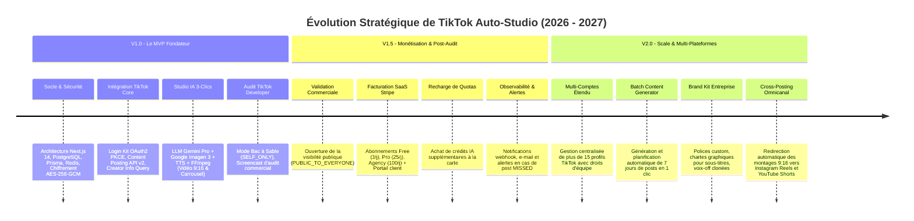

# Strategic Product Roadmap (ROADMAP) — TikTok Auto-Studio

> **Nom du Projet :** TikTok Auto-Studio  
> **Version :** 1.0.0  
> **Statut :** Validé — Vision Stratégique & Jalons de Livraison  
> **Auteur(s) :** Principal Software Architect & Staff Fullstack AI Engineer  
> **Dernière mise à jour :** 30 Octobre 2026

---

## 1. Vision Stratégique Globale

**TikTok Auto-Studio** ambitionne de devenir la plateforme de référence pour l'automatisation éthique, créative et performante sur TikTok. Notre feuille de route est rythmée par les impératifs de conformité réglementaire de ByteDance et l'expansion progressive de la valeur utilisateur.

---

## 2. Découpage Détaillé des Jalons

### Jalon V1.0 : Le MVP Fondateur (Focus Technique & Audit TikTok)
* **Objectif Clé :** Disposer d'une plateforme fonctionnelle de bout en bout et obtenir l'approbation officielle de l'audit commercial par ByteDance.
* **Fonctionnalités Livrées :**
  - Authentification sécurisée OAuth2 PKCE avec scopes `user.info.basic`, `video.publish`, `video.upload`.
  - Chiffrement au repos de grade militaire des tokens via **AES-256-GCM** (zéro secret client).
  - Téléversement manuel d'images et vidéos avec conversion automatique des fichiers PNG en JPEG 95% pour respecter les contraintes strictes TikTok.
  - Hébergement des médias sur domaine vérifié Cloudflare R2 (`https://assets.mondomaine-verifie.com`).
  - Studio IA 3-clics orchestrant Gemini Pro (script JSON), Imagen 3 (visuels 9:16) et montage FFmpeg (Ken Burns + audio + sous-titres `.ass`).
  - Moteur de planification BullMQ avec clé d'idempotence (`jobId: "post_" + id`), verrou Redlock et **règle des 15 minutes** en cas d'interruption serveur.
  - Conformité pré-audit : Visibilité bridée sur `SELF_ONLY` et étiquetage obligatoire `is_aigc: true`.
* **Critères de Passage (Gate V1.0 $\rightarrow$ V1.5) :**
  - [ ] 100% des tests unitaires et d'intégration validés (`pnpm test`).
  - [ ] Screencast de démonstration d'audit enregistré et soumis sur le portail développeur TikTok.
  - [ ] Détection et gestion sans plantage des 5 cas limites (edge cases) majeurs.

---

### Jalon V1.5 : Monétisation, Post-Audit & Observabilité
* **Objectif Clé :** Débloquer la publication publique pour tous les utilisateurs et mettre en place le modèle économique SaaS récurrent.
* **Fonctionnalités Livrées :**
  - Bascule de la variable `TIKTOK_AUDIT_APPROVED="true"` suite à la validation commerciale : libération du mode `PUBLIC_TO_EVERYONE`.
  - Intégration de la passerelle de paiement **Stripe** :
    - Formule **Free** : 1 compte TikTok, 3 générations IA/jour, vidéos de 60s max.
    - Formule **Pro** (29 €/m) : 3 comptes TikTok, 25 générations IA/jour, vidéos de 180s max.
    - Formule **Agency** (99 €/m) : 15 comptes TikTok, 100 générations IA/jour, vidéos de 600s max.
  - Achat de packs d'inférences supplémentaires à la demande (ex: 50 crédits pour 10 €).
  - Centre de notifications utilisateur : alerte immédiate par e-mail / Discord / Telegram lorsqu'un post passe en statut `MISSED` ou `FAILED`.
  - Analyse d'audience basique : taux de complétion des publications et suivi des temps de rendu FFmpeg.
* **Critères de Passage (Gate V1.5 $\rightarrow$ V2.0) :**
  - [ ] 500 utilisateurs actifs enregistrés.
  - [ ] Taux de rétention hebdomadaire $> 40\%$.
  - [ ] Chiffre d'Affaires Récurrent Mensuel (MRR) $> 5\,000\text{ €}$.

---

### Jalon V2.0 : Scale, Intelligence Avancée & Omnicanal
* **Objectif Clé :** Passer d'un outil mono-réseau à une suite complète de distribution vidéo verticale automatisée.
* **Fonctionnalités Livrées :**
  - **Batch Generator en 1 Clic :** L'utilisateur soumet un thème global (ex: *"Semaine spéciale productivité Notion"*), et l'IA génère, monte et positionne sur le calendrier les 7 publications de la semaine.
  - **Brand Kit Personnalisé :** Importation de typographies d'entreprise pour les sous-titres animés, choix des palettes de surbrillance et clonage de voix IA via ElevenLabs.
  - **Distribution Omnicanal (Cross-Posting) :**
    - Connecteur Meta Graph API (Instagram Reels).
    - Connecteur YouTube Data API v3 (YouTube Shorts).
    - Adaptation automatique des légendes et hashtags aux particularités de chaque réseau.
  - **Collaboration d'Équipe Avancée :** Rôles fins pour les agences (Rédacteur, Réviseur, Approbateur final avant diffusion).

---

## 3. Matrice d'Analyse des Risques & Plans de Contingence

| Risque Identifié | Probabilité | Impact | Stratégie d'Atténuation & Contingence |
| :--- | :---: | :---: | :--- |
| **Rejet de l'Audit Commercial TikTok** | Moyenne | Élevé | Respect scrupuleux des directives d'UI (bouton officiel TikTok), limitation préalable en `SELF_ONLY`, vidéo de démonstration ultra-détaillée et contact proactif de l'équipe de review ByteDance. |
| **Suspension d'un Compte Créateur pour Spam IA** | Faible | Élevé | Inclusion systématique du tag `is_aigc: true`, modération amont des prompts, bridage du rythme maximal de publication (max 4 posts/jour par compte). |
| **Dépassement des Coûts d'Inférence IA (Gemini/Imagen)** | Moyenne | Moyen | Quotas stricts par palier d'abonnement, cache Redis sur les prompts similaires, modèle Gemini 1.5 Flash pour les tâches d'analyse rapide. |
| **Surcharge des Workers de Montage FFmpeg** | Moyenne | Moyen | Découpage des workers dans des conteneurs isolés avec auto-scaling horizontal basé sur la profondeur de la file BullMQ. |
| **Perte ou Corruption d'un Refresh Token** | Faible | Élevé | Alerte préventive 15 jours avant l'expiration des 365 jours, procédure de ré-authentification guidée en 1 clic sans perte des données créées. |
