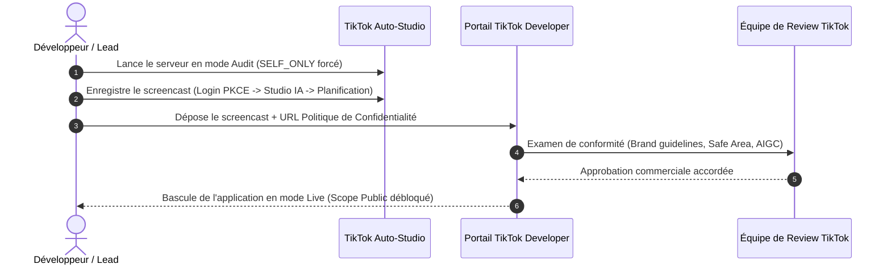
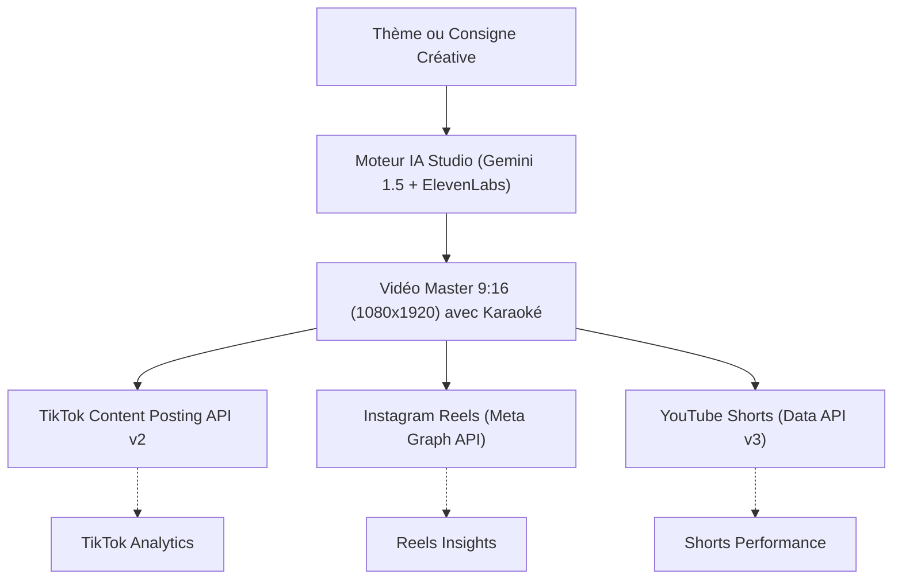

# 🗺️ Feuille de Route Stratégique & Opérationnelle — Suite du Projet
## TikTok Auto-Studio (Versions 1.0 Finale $\rightarrow$ 1.5 SaaS $\rightarrow$ 2.0 Omnicanal)

> **Projet :** TikTok Auto-Studio  
> **Version Actuelle :** 2.5.0 (Socle Monorepo, Sécurité AES-256, Pipeline Multimodal, Frontend Pro & Tests 156/156)  
> **Document :** Guide Directeur des Prochaines Étapes Techniques et Métier  
> **Statut :** Plan Directeur Actif  
> **Dernière mise à jour :** 1er Novembre 2026  

---

## 1. Synthèse de l'Existant (Socle Consolidé)

Le projet dispose d'une infrastructure complète, sécurisée et validée :

```mermaid
flowchart LR
    subgraph BackEnd ["Backend Fastify & Asynchrone"]
        A1["PostgreSQL & Prisma (8 tables)"]
        A2["BullMQ & Redis (Déduplication jobId)"]
        A3["Chiffrement AES-256-GCM (Zéro secret)"]
        A4["Pipeline Gemini Omni, Imagen 3 & Sharp"]
        A5["FFmpeg (Audio Ducking -14dB + .ass)"]
    end

    subgraph FrontEnd ["Frontend React 19 SPA & Vite"]
        B1["Studio 3-Clics & TikTokPreview 9:16"]
        B2["Overlay Safe Area TikTok Interactif"]
        B3["4 Moteurs Karaoké (Hormozi, Submagic, Cyber, Clean)"]
        B4["Générateur Batch 7 Jours en 1 Clic"]
        B5["Analytics Prime-Time & Rétention 3s"]
        B6["Theme Mode Fond Blanc & Nuit Animé"]
    end

    subgraph QA ["Verrouillage Qualité"]
        C1["156 Tests Automatisés (100% PASS)"]
        C2["Dossier tests/suites/ rapatrié dans le dépôt"]
        C3["Conformité ByteDance (is_aigc: true forcé)"]
    end

    BackEnd <--> FrontEnd
    FrontEnd <--> QA
```



---

## 2. Jalon Immédiat : Déploiement & Audit Officiel ByteDance (V1.0)

L'objectif immédiat est d'obtenir la validation commerciale de TikTok pour débloquer la diffusion publique (`PUBLIC_TO_EVERYONE`).



### Plan d'Action Opérationnel Immédiat :
1. **Enregistrement de la Vidéo Démo d'Audit (3 min 30 s) :**
   - Suivre la chronologie détaillée dans [`docs/AUDIT_SCREENCAST_GUIDE.md`](file:///C:/Users/ADMIN/Documents/tiktok-auto-studio/docs/AUDIT_SCREENCAST_GUIDE.md).
   - Séquence 1 : Connexion OAuth2 PKCE via le bouton officiel TikTok (`0:00 - 0:45`).
   - Séquence 2 : Studio IA en 3 clics avec étiquetage `is_aigc: true` bien visible (`0:45 - 2:00`).
   - Séquence 3 : Planification sur le calendrier et respect de la règle des 5 minutes (`2:00 - 3:00`).
   - Séquence 4 : Vérification de la mention légale et de la suppression du compte (`3:00 - 3:30`).
2. **Déploiement Staging & Hébergement Webhook :**
   - **Backend API (Node/Fastify) :** Déploiement sur conteneur Docker (Railway, Fly.io ou VPS Ubuntu).
   - **Frontend SPA (Vite) :** Déploiement CDN Cloudflare Pages ou Vercel.
   - **Stockage Médias (Cloudflare R2) :** Domaine vérifié actif `https://assets.mondomaine-verifie.com`.

---

## 3. Jalon V1.5 : Monétisation SaaS, Stripe & Système de Quotas

Dès l'audit TikTok approuvé, la plateforme bascule en mode commercial payant.

### 3.1. Grille Tarifaire & Quotas d'Inférence
| Palier | Tarif Mensuel | Comptes TikTok | Générations IA / Jour | Durée Vidéo Max | Fonctionnalités Exclusives |
| :--- | :---: | :---: | :---: | :---: | :--- |
| **Free (Découverte)** | 0 € | 1 compte | 3 / jour | 60 secondes | 1 style karaoké, filigrane discret. |
| **Creator Pro** | 29 € / mois | 3 comptes | 25 / jour | 180 secondes | 4 styles karaoké, Batch Hebdo 7 jours, Voix ElevenLabs, Audio Ducking. |
| **Agency Studio** | 99 € / mois | 15 comptes | 100 / jour | 600 secondes | Génération multi-thèmes illimitée, support prioritaire, marque blanche. |

### 3.2. Architecture Technique à Implémenter :
1. **Intégration du SDK Stripe :**
   - Dépendance backend : `stripe` (Node SDK) + schéma Zod pour les webhooks.
   - Route `/api/billing/create-checkout-session` : redirection vers Stripe Checkout.
   - Route `/api/billing/portal` : portail client Stripe pour gestion de carte et factures.
   - Webhook `/api/webhooks/stripe` : traitement des événements `checkout.session.completed`, `customer.subscription.updated`, `invoice.payment_failed`.
2. **Table Relationnelle Prisma pour les Abonnements :**
   - Ajout des modèles `Subscription` et `PaymentAudit` dans `apps/api/prisma/schema.prisma`.
   - Mise à jour dynamique de `dailyLimit` sur l'entité `AiQuota` de l'utilisateur.
3. **Centre de Notifications & Alertes Proactives :**
   - Webhooks Discord / Telegram ou notification e-mail (Resend) lorsqu'un post passe en statut `MISSED` ou `FAILED` pour alerter immédiatement le créateur.

---

## 4. Jalon V2.0 : Distribution Omnicanal & Intelligence Avancée

Passage d'un outil dédié TikTok à une **centrale de diffusion vidéo verticale omnicanale**.



### Fonctionnalités Clés V2.0 :
1. **Connecteurs Cross-Posting :**
   - **Instagram Reels :** Intégration Meta Graph API v20+ pour téléversement direct sans filigrane TikTok.
   - **YouTube Shorts :** Intégration Google YouTube Data API v3 (`videos.insert`).
   - Réécriture automatique des descriptions et hashtags selon la sémantique de chaque plateforme.
2. **Brand Kit Personnalisé & Clonage Vocal :**
   - Importation de typographies `.ttf` ou `.otf` personnalisées pour le générateur de sous-titres FFmpeg `.ass`.
   - Clonage de la voix de l'utilisateur via ElevenLabs Voice Cloning API pour une identité vocale 100% authentique.
3. **Collaboration d'Équipe (Rôles & Permissions) :**
   - Rôles fins : *Créateur*, *Réviseur*, *Approbateur Final* pour les agences marketing gérant plusieurs clients.

---

## 5. Matrice Opérationnelle des Prochains Sprints (Sprints 08 à 11)

| Sprint | Domaine | Tâches Principales | Livrables Attendus | Durée Estimée |
| :---: | :--- | :--- | :--- | :---: |
| **Sprint 08** | **Audit & Déploiement Staging** | Enregistrement screencast, déploiement Docker Fastify + Vite CDN Cloudflare Pages, validation domaine vérifié R2. | Dossier TikTok Developer soumis, app accessible en HTTPS staging. | 2 à 3 jours |
| **Sprint 09** | **Facturation SaaS Stripe** | Routes Stripe Checkout, webhook sécurisé, table Prisma `Subscription`, débridage dynamique des quotas. | Paiements par carte opérationnels, abonnements Pro & Agency actifs. | 3 à 4 jours |
| **Sprint 10** | **Alertes & Centre de Notifications** | Intégration Resend (emails) + Webhooks Discord/Telegram lors d'incidents de publication (`MISSED`). | Notification instantanée en cas de panne réseau ou expiration de token. | 2 jours |
| **Sprint 11** | **Connecteur Instagram Reels** | Meta OAuth2, flux de téléversement container video Reels, adaptation des métadonnées. | Publication simultanée TikTok + Instagram Reels en 1 clic. | 4 jours |

---

## 6. Commandes Utiles pour Continuer

```bash
# 1. Lancement du serveur backend Fastify en local
cd apps/api
pnpm dev

# 2. Lancement du frontend React Vite
cd apps/web
pnpm dev

# 3. Lancement de la recette technique globale (156 tests)
pnpm vitest run

# 4. Compilation de production du frontend
pnpm --filter @tiktok-studio/web build

# 5. Lancement de l'outil d'administration CLI
pnpm --filter @tiktok-studio/api cli --help
```

---

> Ce document sert de feuille de route officielle pour guider les développements futurs et maintenir l'excellence technique du projet **TikTok Auto-Studio**.
