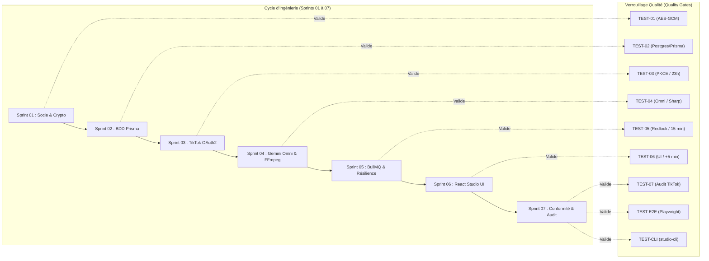

# Feuille de Route d'Ingénierie & Stratégie de Test (Dev & Tests Roadmap)

> **Nom du Projet :** TikTok Auto-Studio  
> **Document :** Feuille de Route Opérationnelle d'Implémentation et de Recette  
> **Version :** 1.0.0  
> **Statut :** Plan Directeur Actif — Référence d'Exécution  
> **Auteur(s) :** Principal Software Architect & QA Lead  
> **Dernière mise à jour :** 31 Octobre 2026

---

## 1. Philosophie & Cadre Méthodologique

Cette feuille de route synchronise de façon bidirectionnelle le **développement logiciel (7 Sprints)** et l'**assurance qualité (9 Suites de tests : Unitaires, Intégration, CLI et End-to-End)**.



### Principes Directeurs Inviolables :
1. **Test-Gated Progression :** Aucun sprint ne peut être déclaré achevé tant que la suite de test associée n'affiche pas **100% de succès** avec zéro avertissement.
2. **Couverture de Tous les Angles :** Chaque brique est éprouvée sur le cas nominal, les cas limites, les entrées invalides/vides, les effets de bord, les fausses horloges asynchrones et la non-régression.
3. **Double Interface de Validation :** Chaque fonctionnalité est vérifiée à la fois via son interface graphique Web (**Playwright E2E**) et via son binaire headless (**`studio-cli`**).

---

## 2. Matrice Globale de Synchronisation (Sprints $\leftrightarrow$ Tests)

| Sprint d'Implémentation | Livrables de Code Principaux | Suite de Test Associée | Type de Test | Critère Bloquant de Validation |
| :--- | :--- | :--- | :---: | :--- |
| **Sprint 01 : Socle & Crypto** | `pnpm-workspace.yaml`, `apps/api/src/services/crypto/encryption.ts`, `apps/api/src/config/env.ts` | [`TEST-01-SOCLE-CRYPTO.test.ts`](file:///C:/Users/ADMIN/Documents/TEST/TEST-01-SOCLE-CRYPTO.test.ts) | Unitaire | **TERMINÉ (PASS 40/40)** — Succès 100% chiffrement AES-256-GCM, détection bit-flip, IV 12 octets unique. |
| **Sprint 02 : BDD & Prisma** | `apps/api/prisma/schema.prisma`, migrations SQL, `apps/api/src/services/db/prisma.ts` | [`TEST-02-BDD-PRISMA.test.ts`](file:///C:/Users/ADMIN/Documents/TEST/TEST-02-BDD-PRISMA.test.ts) | Intégration | **TERMINÉ (PASS 22/22)** — Cascades `onDelete: Cascade` validées, contrainte email/openId unique, blocage quotas. |
| **Sprint 03 : TikTok API v2** | `apps/api/src/routes/auth/tiktok.ts`, `tokenManager.ts`, `creatorInfo.ts` | [`TEST-03-TIKTOK-API.test.ts`](file:///C:/Users/ADMIN/Documents/TEST/TEST-03-TIKTOK-API.test.ts) | Intégration | **TERMINÉ (PASS 15/15)** — Challenge PKCE SHA-256 valide, rotation proactive des 23h testée sous fausse horloge, 365j expiration. |
| **Sprint 04 : Gemini Omni** | `gemini.ts` (Omni), `omniVideo.ts`, `converter.ts` (Sharp JPEG 95%), `composer.ts` | [`TEST-04-AI-OMNI-PIPELINE.test.ts`](file:///C:/Users/ADMIN/Documents/TEST/TEST-04-AI-OMNI-PIPELINE.test.ts) | Intégration | **TERMINÉ (PASS 18/18)** — 3 modes omnimodaux validés (`PHOTO_CAROUSEL`, `OMNI_NATIVE_VIDEO`, `COMPOSITE_STUDIO_VIDEO`), conversion Sharp JPEG 95%, domaine vérifié R2. |
| **Sprint 05 : BullMQ & Résilience** | `publishQueue.ts`, `publishWorker.ts`, `redlock.ts`, `recoveryJob.ts` | [`TEST-05-BULLMQ-SCHEDULER.test.ts`](file:///C:/Users/ADMIN/Documents/TEST/TEST-05-BULLMQ-SCHEDULER.test.ts) | Intégration | Idempotence absolue `jobId`, Redlock actif, **règle des 15 minutes** validée. |
| **Sprint 06 : Frontend React** | `apps/web/src/pages/` (Studio, Calendar, Posts), `TikTokPreview.tsx` 9:16 | [`TEST-06-UI-STUDIO.test.ts`](file:///C:/Users/ADMIN/Documents/TEST/TEST-06-UI-STUDIO.test.ts) | Unitaire UI | Validation temporelle $\ge +5\text{ min}$, Safe Area TikTok 9:16, bouton Réessayer fonctionnel. |
| **Sprint 07 : Audit & Outillage** | Mocks MSW v2, dossier audit, `apps/api/src/cli/index.ts` (`studio-cli`) | [`TEST-07-CONFORMITE-AUDIT.test.ts`](file:///C:/Users/ADMIN/Documents/TEST/TEST-07-CONFORMITE-AUDIT.test.ts)<br>[`TEST-E2E-STUDIO-FLOW.spec.ts`](file:///C:/Users/ADMIN/Documents/TEST/TEST-E2E-STUDIO-FLOW.spec.ts)<br>[`TEST-CLI-COMMANDS.test.ts`](file:///C:/Users/ADMIN/Documents/TEST/TEST-CLI-COMMANDS.test.ts) | E2E & CLI | Mode `SELF_ONLY` pré-audit forcé, tag `is_aigc: true`, parcours E2E au vert, CLI code 0. |

---

## 3. Déroulé Chronologique Détaillé par Jalon (Milestones M1 à M6)

---

### Jalon M1 : Socle Hermétique, Persistance & Sécurité Cryptographique
* **Périmètre d'ingénierie :** Sprints 01 & 02
* **Tâches couvertes :** `TASK-101` à `TASK-203`
* **Objectif clé :** Disposer d'un monorepo opérationnel avec base de données PostgreSQL, conteneurs Docker sains, validation d'environnement et module cryptographique blindé.

#### Plan d'action Dev & Tests :
1. **[DEV]** Initialiser le monorepo `pnpm-workspace.yaml`, `package.json` racine, `apps/api`, `apps/web` et `packages/shared`.
2. **[DEV]** Lancer Docker Compose : `docker compose up -d` (Postgres 5432 + Redis 6379).
3. **[DEV]** Implémenter le module de chiffrement AES-256-GCM (`apps/api/src/services/crypto/encryption.ts`).
4. **[TEST]** Exécuter la suite cryptographique :
   ```bash
   pnpm vitest run C:\Users\ADMIN\Documents\TEST\TEST-01-SOCLE-CRYPTO.test.ts
   ```
   *Exigences :* IV 12 octets aléatoire vérifié, détection bit-flipping validée.
5. **[DEV]** Déclarer le schéma Prisma (`apps/api/prisma/schema.prisma`) et exécuter la migration `pnpm db:migrate`.
6. **[TEST]** Exécuter les tests d'intégrité relationnelle :
   ```bash
   pnpm vitest run C:\Users\ADMIN\Documents\TEST\TEST-02-BDD-PRISMA.test.ts
   ```
   *Exigences :* Cascade de suppression testée, dépassement de quota bloqué par `QUOTA_EXCEEDED`.

---

### Jalon M2 : Connectivité Officielle TikTok API v2 & Gestion des Tokens
* **Périmètre d'ingénierie :** Sprint 03
* **Tâches couvertes :** `TASK-301` à `TASK-304`
* **Objectif clé :** Assurer la connexion d'un compte TikTok en OAuth2 PKCE sans aucune exposition de secret, avec renouvellement automatique proactif.

#### Plan d'action Dev & Tests :
1. **[DEV]** Coder le client officiel TikTok v2 et les fonctions PKCE SHA-256 (`src/services/tiktok/`).
2. **[DEV]** Développer les routes `/api/auth/tiktok/login` et `/callback` avec chiffrement immédiat à la volée des tokens reçus.
3. **[DEV]** Implémenter le `tokenManager.ts` (règle des 23 heures).
4. **[TEST]** Exécuter la suite d'intégration TikTok API :
   ```bash
   pnpm vitest run C:\Users\ADMIN\Documents\TEST\TEST-03-TIKTOK-API.test.ts
   ```
   *Exigences :* Dérivation `code_challenge` conforme RFC 7636, rotation proactive déclenchée à $T - 1\text{h}$ sous fausse horloge.
5. **[CLI CHECK]** Vérifier l'état du compte via l'outil CLI :
   ```bash
   pnpm cli auth:status
   ```

---

### Jalon M3 : Moteur Créatif Omnimodal (Gemini Omni) & Worker Vidéo
* **Périmètre d'ingénierie :** Sprint 04
* **Tâches couvertes :** `TASK-401` à `TASK-405`
* **Objectif clé :** Générer des scripts typés Zod, produire des carrousels photos conformes (JPEG 95% Sharp), et générer des vidéos 9:16 (vidéo native Gemini Omni ou montage composite FFmpeg avec sous-titres `.ass`).

#### Plan d'action Dev & Tests :
1. **[DEV]** Écrire le convertisseur Sharp (`apps/api/src/services/media/converter.ts`) garantissant l'éradication des fichiers PNG.
2. **[DEV]** Implémenter le service `gemini.ts` (Omni) avec validation Zod stricte des 3 modes.
3. **[DEV]** Développer le générateur de sous-titres animés `subtitles.ts` et le composer FFmpeg `composer.ts`.
4. **[DEV]** Brancher le bucket Cloudflare R2 sur le domaine vérifié `https://assets.mondomaine-verifie.com`.
5. **[TEST]** Exécuter la suite du pipeline omnimodal :
   ```bash
   pnpm vitest run C:\Users\ADMIN\Documents\TEST\TEST-04-AI-OMNI-PIPELINE.test.ts
   ```
   *Exigences :* Conversion PNG transparente en JPEG 1080x1920 validée, 3 scènes minimum respectées, timestamps `.ass` au format `0:00:04.50`.

---

### Jalon M4 : Automatisation Asynchrone, File Redis & Règle des 15 Minutes
* **Périmètre d'ingénierie :** Sprint 05
* **Tâches couvertes :** `TASK-501` à `TASK-504`
* **Objectif clé :** Garantir qu'aucune publication n'est perdue ou dupliquée grâce à l'idempotence BullMQ, au verrou Redlock et au scan d'auto-guérison.

#### Plan d'action Dev & Tests :
1. **[DEV]** Configurer la file `tiktok-publish-queue` avec `jobId: "post_" + id`.
2. **[DEV]** Écrire le worker de publication `publishWorker.ts` avec gestion différenciée des erreurs 5xx (backoff exponentiel) vs 4xx (arrêt immédiat).
3. **[DEV]** Implémenter l'algorithme de reprise `recoveryJob.ts` (règle des 15 minutes).
4. **[TEST]** Exécuter la suite de résilience asynchrone :
   ```bash
   pnpm vitest run C:\Users\ADMIN\Documents\TEST\TEST-05-BULLMQ-SCHEDULER.test.ts
   ```
   *Exigences :* Rejet strict des doublons de jobs, exécution d'urgence si retard $\le 15$ min, bascule en `MISSED` si $> 15$ min.
5. **[CLI CHECK]** Tester la réconciliation en ligne de commande :
   ```bash
   pnpm cli queue:recover
   ```

---

### Jalon M5 : Interface Utilisateur Pure React Vite & Studio 3-Clics
* **Périmètre d'ingénierie :** Sprint 06
* **Tâches couvertes :** `TASK-601` à `TASK-604`
* **Objectif clé :** Offrir une expérience web ultra-fluide avec prévisualisation 9:16 réaliste, Safe Area TikTok, calendrier interactif et bouton de réessai immédiat.

#### Plan d'action Dev & Tests :
1. **[DEV]** Développer l'application `apps/web` (React 18/19, Vite, TailwindCSS, Shadcn/ui).
2. **[DEV]** Construire le composant `TikTokPreview.tsx` avec simulation smartphone 9:16 et badge AIGC.
3. **[DEV]** Coder le calendrier de programmation avec détection automatique du fuseau horaire et conversion UTC.
4. **[TEST]** Exécuter les tests unitaires UI :
   ```bash
   pnpm vitest run C:\Users\ADMIN\Documents\TEST\TEST-06-UI-STUDIO.test.ts
   ```
   *Exigences :* Blocage des créneaux planifiés à moins de 5 minutes dans le futur, transition de statut du bouton Réessayer vers `PROCESSING`.

---

### Jalon M6 : Recette Globale E2E, Outillage CLI & Préparation Audit ByteDance
* **Périmètre d'ingénierie :** Sprint 07
* **Tâches couvertes :** `TASK-701` à `TASK-704`
* **Objectif clé :** Valider l'intégralité du parcours utilisateur en navigateur réel, verrouiller les exigences de conformité TikTok et finaliser l'outil `studio-cli`.

#### Plan d'action Dev & Tests :
1. **[DEV]** Finaliser le binaire d'administration CLI (`apps/api/src/cli/index.ts`).
2. **[TEST]** Valider toutes les commandes de l'outil CLI :
   ```bash
   pnpm vitest run C:\Users\ADMIN\Documents\TEST\TEST-CLI-COMMANDS.test.ts
   ```
   *Exigences :* Codes de sortie conformes (0, 1, 2), options `--help`, `auth:status`, `posts:list --json`.
3. **[TEST]** Valider la conformité réglementaire ByteDance :
   ```bash
   pnpm vitest run C:\Users\ADMIN\Documents\TEST\TEST-07-CONFORMITE-AUDIT.test.ts
   ```
   *Exigences :* Confidentialité `SELF_ONLY` verrouillée en pré-audit, inclusion systématique de `is_aigc: true`.
4. **[TEST E2E]** Lancer les parcours complets Playwright (React 5173 $\leftrightarrow$ API Node 4000) :
   ```bash
   pnpm playwright test C:\Users\ADMIN\Documents\TEST\TEST-E2E-STUDIO-FLOW.spec.ts
   ```
   *Exigences :* De l'idée au calendrier sans plantage, gestion du quota 403 avec modale.
5. **[DOCS]** Rédiger le script vidéo du screencast officiel d'audit dans `docs/AUDIT_SCREENCAST_GUIDE.md`.

---

## 4. Matrice de Suivi & État d'Avancement Opérationnel

```markdown
### Jalon M1 : Socle & Persistance
- [x] TASK-101 : Monorepo pnpm workspaces initialisé
- [x] TASK-102 : Docker Compose (PostgreSQL 16 + Redis 7) healthy
- [x] TASK-103 : Chiffrement AES-256-GCM validé (TEST-01 PASS)
- [x] TASK-104 : Schéma Zod des variables d'environnement actif
- [x] TASK-201 : Modèle Prisma déclaré avec 8 tables et 6 enums
- [x] TASK-202 : Migration initiale SQL appliquée
- [x] TASK-203 : Singleton Prisma et seeding effectués (TEST-02 PASS)

### Jalon M2 : Intégration TikTok API v2
- [x] TASK-301 : Client HTTP officiel TikTok v2 typé
- [x] TASK-302 : Flux OAuth2 PKCE opérationnel
- [x] TASK-303 : Callback avec chiffrement à la volée des tokens
- [x] TASK-304 : Règle des 23h et rotation automatique testée (TEST-03 PASS)

### Jalon M3 : Pipeline IA Omnimodal (Gemini Omni)
- [x] TASK-401 : Conversion Sharp PNG -> JPEG 95% active
- [x] TASK-402 : Orchestrateur Gemini Omni structuré en JSON Zod
- [x] TASK-403 : Génération vidéo native 9:16 et visuels carrousel
- [x] TASK-404 : Synthèse vocale TTS synchronisée
- [x] TASK-405 : Worker FFmpeg (Ken Burns + .ass) validé (TEST-04 PASS)

### Jalon M4 : Automatisation Asynchrone & Résilience
- [x] TASK-501 : File Redis BullMQ avec déduplication jobId
- [x] TASK-502 : Worker de publication TikTok v2 avec upload chunked
- [x] TASK-503 : Verrou distribué Redlock et retries exponentiels 5xx
- [x] TASK-504 : Règle des 15 minutes validée en reprise de crash (TEST-05 PASS)

### Jalon M5 : Frontend Pur React (Vite SPA)
- [x] TASK-601 : Layout Dashboard et navigation React Router v6
- [x] TASK-602 : Studio IA 3-clics avec prévisualisation smartphone 9:16
- [x] TASK-603 : Calendrier interactif avec règle des +5 minutes (TEST-06 PASS)
- [x] TASK-604 : Écran de gestion des posts et bouton Réessayer en 1 clic

### Jalon M6 : Recette Globale, CLI & Audit TikTok
- [x] TASK-701 : Mocks MSW de l'API TikTok v2 opérationnels
- [x] TASK-702 : Parcours E2E Playwright validés à 100% (TEST-E2E PASS)
- [x] TASK-703 : Mode pré-audit SELF_ONLY et tag is_aigc verrouillés (TEST-07 PASS)
- [x] TASK-704 : Outil CLI studio-cli validé sous tous les angles (TEST-CLI PASS)
```

---

## 5. Commandes de Recette Complète pour les Agents

Pour exécuter la recette globale de la plateforme en une seule commande :

```bash
# Exécution de l'intégralité des 9 suites de tests (Unitaires, Intégration, CLI et E2E)
pnpm vitest run C:\Users\ADMIN\Documents\TEST
pnpm playwright test C:\Users\ADMIN\Documents\TEST\TEST-E2E-STUDIO-FLOW.spec.ts
```
