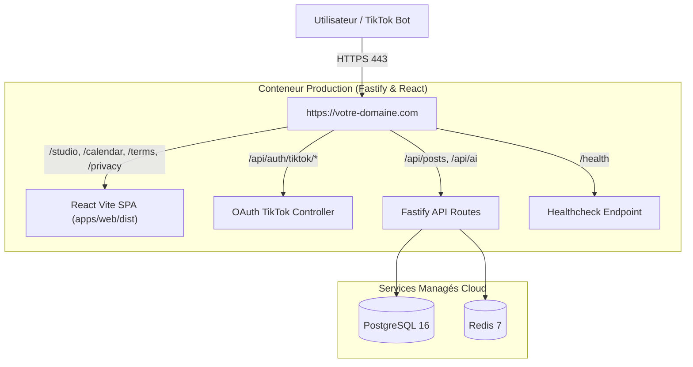

# 🚀 Guide d'Hébergement en Production — TikTok Auto Studio

*Ce guide détaille la mise en place d'un **véritable hébergement Cloud 24/7** avec nom de domaine HTTPS permanent, éliminant les pages statiques GitHub Pages et les tunnels locaux éphémères.*

---

## 1. Pourquoi abandonner GitHub Pages & Localtunnel ?

| Critère | Ancien Setup (Pages Statiques + Tunnel) | Vrai Hébergement Cloud (Nouveau Standard) |
| :--- | :--- | :--- |
| **Type** | HTML statique figé sur GitHub Pages | **Application Web React complète + API Fastify 24/7** |
| **Disponibilité** | S'arrête dès que votre PC ou le terminal est fermé | **Haute disponibilité 99.9% dans le Cloud** |
| **URL Callback** | Change à chaque redémarrage de `localtunnel` | **URL HTTPS permanente et certifiée** |
| **Base de Données** | PostgreSQL local dans Docker Desktop | **PostgreSQL managé avec sauvegardes automatiques** |
| **File de Tâches** | Redis local | **Redis Cloud managé (BullMQ actif 24h/24)** |
| **Validation TikTok** | Risque de rejet pour instabilité | **Conforme aux exigences de production ByteDance** |

---

## 2. Architecture Unifiée du Déploiement

Le projet a été restructuré pour permettre un **hébergement Full-Stack unifié en un seul conteneur** :



* **Zéro problème de CORS** : Le frontend et l'API partagent la même origine.
* **Toutes les URLs TikTok officielles sur le même domaine** :
  * **Site Web de l'application** : `https://votre-domaine.com/`
  * **Politique de Confidentialité** : `https://votre-domaine.com/privacy`
  * **Conditions d'Utilisation** : `https://votre-domaine.com/terms`
  * **Redirect URI OAuth TikTok** : `https://votre-domaine.com/api/auth/tiktok/callback`
  * **Vérification d'état** : `https://votre-domaine.com/health`

---

## 3. Option Recommandée 1 : Render.com (100% Automatisé via Blueprint)

Grâce au fichier [`render.yaml`](file:///C:/Users/ADMIN/Documents/tiktok-auto-studio/render.yaml) déjà configuré à la racine du dépôt, Render déploie l'intégralité de l'infrastructure en 1 clic.

### Étapes de déploiement :
1. Créez un compte gratuit sur [Render.com](https://render.com).
2. Rendez-vous sur votre tableau de bord et cliquez sur **« New + » > « Blueprint »**.
3. Connectez votre compte GitHub et sélectionnez le dépôt **`GeovanioH/tiktok-auto-studio`**.
4. Render détecte automatiquement `render.yaml` et prépare 3 ressources :
   * **`tiktok-auto-studio`** : Le conteneur Web unifié (Node.js/Fastify + React).
   * **`tiktok-postgres`** : La base de données PostgreSQL managée.
   * **`tiktok-redis`** : Le cache Redis managé pour BullMQ.
5. Renseignez vos clés secrètes dans l'interface Render :
   * `TIKTOK_CLIENT_KEY` : Votre clé développeur TikTok.
   * `TIKTOK_CLIENT_SECRET` : Votre secret développeur TikTok.
   * `TIKTOK_REDIRECT_URI` : `https://tiktok-auto-studio.onrender.com/api/auth/tiktok/callback` (ou votre domaine personnalisé).
6. Cliquez sur **« Apply »**. En moins de 3 minutes, votre application est en ligne avec certificat SSL Let's Encrypt automatique !

---

## 4. Option 2 : Railway.app (Déploiement Continu Simple)

Railway prend nativement en charge le [`Dockerfile`](file:///C:/Users/ADMIN/Documents/tiktok-auto-studio/Dockerfile) et le fichier [`railway.json`](file:///C:/Users/ADMIN/Documents/tiktok-auto-studio/railway.json) inclus dans le projet.

### Étapes :
1. Rendez-vous sur [Railway.app](https://railway.app) et connectez votre compte GitHub.
2. Cliquez sur **« New Project » > « Deploy from GitHub repo »** et choisissez `tiktok-auto-studio`.
3. Cliquez sur **« + New »** dans le canevas de votre projet pour ajouter :
   * Une base **PostgreSQL**.
   * Une base **Redis**.
4. Railway génère automatiquement les variables `DATABASE_URL` et `REDIS_URL`.
5. Dans les paramètres du service web, générez un domaine public (ex: `https://tiktok-auto-studio.up.railway.app`).
6. Ajoutez vos clés TikTok dans l'onglet **Variables**. Le build se lance automatiquement.

---

## 5. Option 3 : VPS Dédié avec Docker Compose & Caddy (Auto-HTTPS)

Si vous disposez de votre propre serveur VPS (Hetzner, OVH, DigitalOcean, Scaleway, AWS Lightsail) :

### Fichiers prêts à l'emploi :
* [`Dockerfile`](file:///C:/Users/ADMIN/Documents/tiktok-auto-studio/Dockerfile) : Image multi-stage optimisée Alpine Linux.
* [`docker-compose.prod.yml`](file:///C:/Users/ADMIN/Documents/tiktok-auto-studio/docker-compose.prod.yml) : Orchestre Caddy (proxy inverse HTTPS automatique), l'application unifiée, PostgreSQL 16 et Redis 7.
* [`Caddyfile`](file:///C:/Users/ADMIN/Documents/tiktok-auto-studio/Caddyfile) : Gestion automatique des certificats SSL Let's Encrypt.

### Lancement sur votre serveur :
```bash
# 1. Cloner le projet sur votre VPS
git clone https://github.com/GeovanioH/tiktok-auto-studio.git
cd tiktok-auto-studio

# 2. Configurer votre domaine et vos secrets dans .env
cp .env.example .env
nano .env

# 3. Lancer la pile de production en arrière-plan
DOMAIN=votre-domaine.com docker compose -f docker-compose.prod.yml up -d --build
```
Caddy contacte immédiatement Let's Encrypt pour délivrer un certificat SSL A+ valide sur votre domaine.

---

## 6. Récapitulatif pour le TikTok Developer Portal

Dès que votre véritable hébergement est en ligne (par exemple sur `https://tiktok-auto-studio.onrender.com` ou votre domaine propre), mettez à jour votre application sur le portail développeur TikTok :

| Paramètre TikTok | Ancienne Valeur (Bricolage) | Nouvelle Valeur Définitive |
| :--- | :--- | :--- |
| **App Name** | `Auto Studio AI` | `Auto Studio AI` |
| **Category** | `Business` | `Business` |
| **Web / Desktop URL** | `https://geovanioh.github.io/tiktok-auto-studio/` | `https://<votre-domaine-cloud>/` |
| **Terms of Service** | Lien brut GitHub | `https://<votre-domaine-cloud>/terms` |
| **Privacy Policy** | Lien brut GitHub | `https://<votre-domaine-cloud>/privacy` |
| **Redirect URI (OAuth)** | `https://<tunnel>.loca.lt/api/...` | `https://<votre-domaine-cloud>/api/auth/tiktok/callback` |
